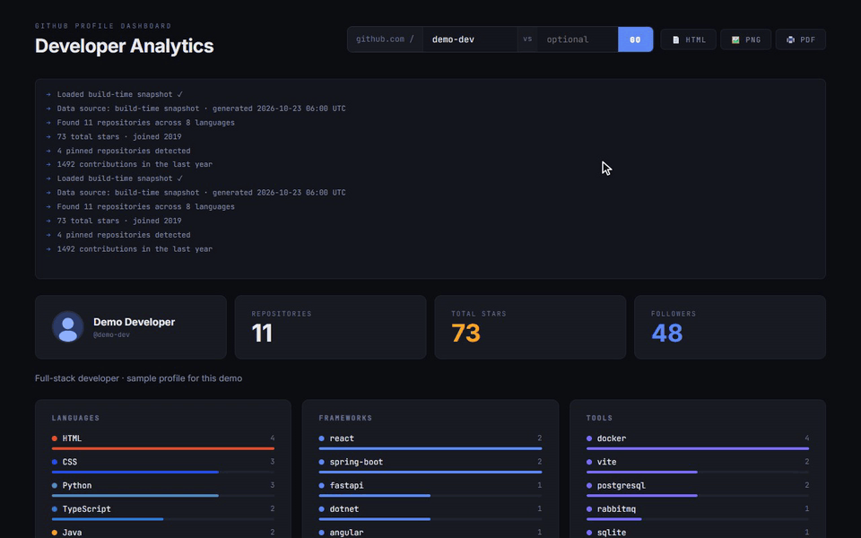
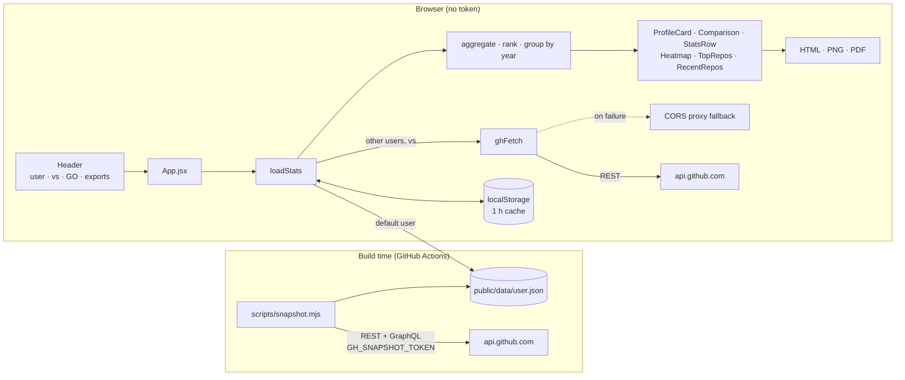
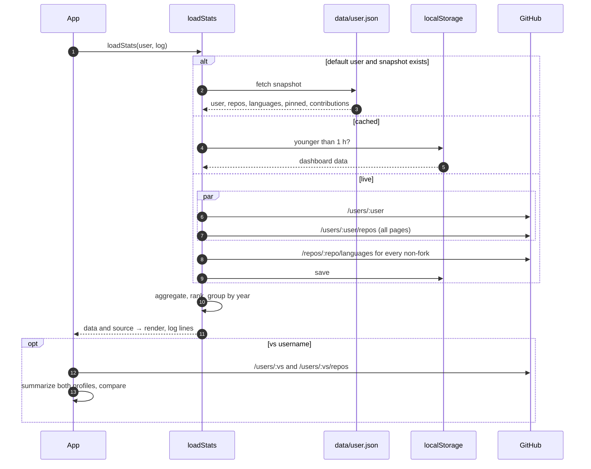

<div align="center">

# 📊 GitHub Dashboard

[](https://github.com/pero-grubac/github-dashboard/actions/workflows/ci.yml)
[](https://github.com/pero-grubac/github-dashboard/actions/workflows/deploy.yml)


**A one-page analytics dashboard for any GitHub profile: languages, frameworks, tools, a contribution heatmap, top repositories and a side-by-side comparison with another user, exportable as HTML, PNG or PDF.**

[](https://pero-grubac.github.io/github-dashboard/)



</div>

---

## 📌 Project Overview

**GitHub Dashboard** turns a public GitHub profile into a dark, terminal-flavoured analytics page. It reads the profile and every repository from the GitHub REST API, counts languages per repository, sorts repository topics into frameworks and tools, ranks the best repositories and shows what was updated last.

There is no backend and **no token in the browser**. The default profile is fetched at build time by `npm run snapshot` (optionally with a token, in CI only) and shipped as a static JSON file; any other username is loaded live from the public API.

---

## ✨ Features

- 👤 **Profile**: avatar, name, location, bio, public repositories, total stars, followers
- 🌐 **Languages**: top 8 by number of repositories, from each repository's language bytes
- 🧩 **Frameworks & tools**: repository topics matched against curated lists (React, .NET, Spring Boot… / Docker, PostgreSQL, Vite…)
- 📈 **Repositories by year**: when the repositories were created
- 🟩 **Contribution heatmap**: GitHub-style calendar of the last year (SVG, month labels, a tooltip per day, total), for the default profile from the snapshot
- ⭐ **Top repositories**: pinned ones first (from the snapshot), then ranked by stars, forks and description
- 🕒 **Recently updated**: the six most recently updated repositories
- 🆚 **Compare two users**: an optional "vs" username loads a second profile and shows repositories, stars, followers, account age and top-language overlap side by side
- 📦 **Build-time snapshot**: the default profile loads from one static JSON file, without API calls or a token in the bundle
- 📄 **Exports**: **HTML** (self-contained file, all user text escaped), **PNG** (image of the dashboard) and **PDF** (print stylesheet + the browser's "Save as PDF")
- 💾 **One-hour cache** per username in `localStorage` for live profiles
- 🖥️ **Terminal log** that narrates each loading step, including the data source
- 📱 **Responsive**: three-column stats, a scrollable heatmap, a stacked comparison and a single column of repositories on phones

---

## 🛠️ Tech Stack

| Technology | Usage |
|------------|-------|
| React 19 | UI (inline-style components, no UI library) |
| Vite 8 | Dev server and bundler |
| GitHub REST API v3 | Profile, repositories, languages (snapshot script and browser) |
| GitHub GraphQL API v4 | Pinned repositories and contribution calendar (snapshot script, with a token) |
| html-to-image | PNG export (loaded on first use, ~5 kB gzipped) |
| `localStorage` | One-hour cache |
| ESLint 10 | Linting |
| `node:test` | Unit tests: aggregation, heatmap layout, comparison, snapshot, HTML export |
| Playwright | End-to-end smoke tests (desktop and mobile, GitHub API mocked) |
| Lighthouse CI | Performance, accessibility, best practices, SEO report |
| GitHub Actions + GitHub Pages | CI, daily data refresh and deployment |

---

## 📁 Project Structure

```
github-dashboard/
├── index.html
├── vite.config.js                  base: '/github-dashboard/'
├── eslint.config.js
├── playwright.config.js
├── lighthouserc.json
├── .env.example                    GITHUB_TOKEN placeholder (snapshot script only)
├── scripts/
│   └── snapshot.mjs                Build-time snapshot → public/data/<user>.json
├── public/data/                    Generated snapshot (git-ignored)
├── src/
│   ├── main.jsx
│   ├── App.jsx                     Layout, loading flow, terminal log
│   ├── index.css                   Global reset and responsive overrides
│   ├── api/
│   │   ├── ghFetch.js              REST calls with pagination and proxy fallback (no token)
│   │   ├── snapshot.js             Loads and validates the build-time snapshot
│   │   └── loadStats.js            Snapshot or live fetch → aggregate → rank → cache
│   ├── constants/
│   │   ├── config.js               DEFAULT_USER
│   │   └── theme.js                Colours and language colours
│   ├── utils/
│   │   ├── exportHTML.js           Builds and downloads the standalone HTML file
│   │   ├── exportImage.js          PNG export and print-to-PDF
│   │   ├── heatmap.js              Contribution calendar layout (weeks, levels, month labels)
│   │   ├── compare.js              Profile summary and comparison
│   │   └── source.js               Data source label
│   └── components/
│       ├── ui/                     Card, Stat, SectionTitle, TermLog
│       ├── charts/                 LangBars, BarChart
│       └── dashboard/              Header, ProfileCard, Comparison, StatsRow, Heatmap, TopRepos, RecentRepos
├── tests/                          node:test suites
│   └── e2e/                        Playwright smoke tests and fixtures
├── readme_assets/demo.gif
└── .github/workflows/
    ├── ci.yml                      Unit/lint/build, e2e and Lighthouse on pull requests and branches
    └── deploy.yml                  Snapshot, build, e2e, deploy to GitHub Pages (also daily)
```

---

## 📦 Installation

You need [Node.js](https://nodejs.org/) 20 or newer and npm.

```bash
git clone https://github.com/pero-grubac/github-dashboard.git
cd github-dashboard
npm install
```

### Snapshot and token (optional)

The browser never holds a token. Data that needs authentication (pinned repositories, the contribution calendar) is fetched **at build time** by `scripts/snapshot.mjs` and written to `public/data/<user>.json`:

```bash
npm run snapshot                                   # unauthenticated: profile, repos, languages
GITHUB_TOKEN=github_pat_xxxx npm run snapshot      # + pinned repositories + contribution heatmap
SNAPSHOT_USER=octocat npm run snapshot             # another user (default: DEFAULT_USER)
```

The script also reads `GITHUB_TOKEN` from `.env.local` (see `.env.example`). Vite only exposes `VITE_*` variables to the app, so the token stays out of the bundle. Use a **fine-grained personal access token** with **Public repositories (read-only)** and an expiry date. Without a token the script prints a warning and still writes a snapshot (60 requests/hour, no pinned repositories, no heatmap).

Without any snapshot (e.g. a fresh clone running `npm run dev`) the app simply loads the default profile live.

---

## ▶️ Usage

```bash
npm run dev        # http://localhost:5173/github-dashboard/
```

1. The default profile loads on its own (`DEFAULT_USER` in `src/constants/config.js`), from the build-time snapshot when there is one. The terminal log and the footer show the data source.
2. Type another username and press **GO** or Enter; it loads live from the public API.
3. **Compare:** put a second username in the **vs** field and press **GO**. A comparison card shows both profiles side by side (stacked on phones): repositories, stars, followers and account age, with the leader of each row highlighted, plus the top five languages of each and their overlap. Both sides are counted the same way (primary language of own repositories), and the second profile costs only two requests.
4. **Exports:**
   - **HTML** downloads `github-dashboard-<user>.html`, a self-contained file that opens offline.
   - **PNG** downloads `github-dashboard-<user>.png`, an image of the dashboard at 2× resolution.
   - **PDF** opens the print dialog; choose "Save as PDF". The print stylesheet hides the controls and the log and keeps the dark theme.

### Scripts

| Command | Description |
|---------|-------------|
| `npm run dev` | Dev server |
| `npm run snapshot` | Write `public/data/<user>.json` (uses `GITHUB_TOKEN` and `SNAPSHOT_USER` if set) |
| `npm run build` | Production build to `dist/` (includes `public/data/`) |
| `npm run preview` | Serve the production build |
| `npm run lint` | ESLint |
| `npm test` | Unit tests (`node --test`) |
| `npm run test:e2e` | Playwright smoke tests (builds and serves the app itself) |

---

## 🏗️ Architecture



### Loading a profile



### Snapshot file

`public/data/<user>.json` holds the raw inputs, not the computed dashboard, so the same aggregation code runs for snapshot and live data:

| Field | Content |
|-------|---------|
| `generatedAt` | ISO time of the snapshot (shown in the log and footer) |
| `authenticated` | Whether a token was used |
| `user` | `/users/:user` |
| `repos` | `/users/:user/repos`, trimmed to the fields the dashboard reads |
| `languages` | `/repos/:repo/languages` per non-fork, keyed by `full_name` |
| `pinned` | Pinned repositories (GraphQL, token only) |
| `contributions` | `{ total, days: [{ date, count }] }` from the contribution calendar (GraphQL, token only) |

### Top repository score

```
score = stars × 3 + forks × 2 + 5 + (has description ? 2 : 0)
```

Pinned repositories always come first; the rest of the nine slots are filled by score.

---

## 🚀 CI/CD

| Workflow | Runs on | Jobs |
|----------|---------|------|
| `ci.yml` | Every push (including `main`) and pull request | **test**: lint, unit tests, build · **e2e**: Playwright smoke tests (desktop + mobile) · **lighthouse**: Lighthouse CI report on the built site |
| `deploy.yml` | After **CI passes on `main`**, a manual run, or **daily at 04:17 UTC** (fresh data) | `npm run snapshot` with `GH_SNAPSHOT_TOKEN`, build, then deploy `dist/` to GitHub Pages |

Deploy is chained to CI (`workflow_run`): a push to `main` is tested once, and only a green run is published, from exactly the commit that was tested. Documentation-only commits start neither.

CI **skips documentation-only changes** (`*.md`, `readme_assets/`, `LICENSE`, `.gitignore`, `.env.example`, `.vscode/`), cache npm downloads and cancel superseded runs. The daily run only refreshes the snapshot data; it does not change the repository.

The e2e tests never touch the real API: `api.github.com`, avatars and fonts are answered with `page.route`, and the snapshot comes from `tests/e2e/fixtures/snapshot.json`. They cover the snapshot load (no API calls), the heatmap, the live fallback, the comparison (side by side and stacked on phones, no horizontal scroll), the three exports and the print stylesheet, and fail on any console error.

### Deployment setup (once)

1. **Settings → Pages → Build and deployment → Source**: **GitHub Actions**.
2. Optional but recommended: create a fine-grained token (**Public repositories, read-only**, with an expiry date) and add it as the repository secret **`GH_SNAPSHOT_TOKEN`** (**Settings → Secrets and variables → Actions**). It enables pinned repositories and the heatmap and raises the rate limit. Without it the snapshot step runs unauthenticated. If GitHub refuses the snapshot (rate limit, expired token), the deploy stops and the previous deployment, with its snapshot, stays online; re-run the workflow once the limit resets.
3. If an older `VITE_GITHUB_TOKEN` secret exists, delete it; nothing uses it any more.

### 🔐 Security

- No token is ever bundled. Earlier versions read `VITE_GITHUB_TOKEN`, and Vite embeds `VITE_*` variables in the JavaScript, where anyone can read them. The token now lives only in the `GITHUB_TOKEN` environment of the snapshot step.
- The snapshot contains only public data (profile, public repositories, pinned repositories, the public contribution count per day).
- Exported HTML escapes every user-provided string.

---

## 🧭 Design Decisions

- **Client-only.** The GitHub API supports CORS, so the app can be a static site on GitHub Pages.
- **Languages by repository count**, not by bytes: one large project should not drown out the rest.
- **Curated framework and tool lists.** Topics are free text; only known names are shown, so personal tags don't clutter the charts.
- **Escaped export.** Names, descriptions and bios come from other users, so the HTML snapshot escapes them before writing the file.
- **Snapshot instead of a token.** Authenticated data is fetched once per build and served as a static file: no secret in the browser, no API calls for the default profile, and pinned repositories plus the heatmap without a backend.
- **Raw data in the snapshot.** It stores what the API returned, not the rendered numbers, so improving the aggregation needs no new snapshot format.
- **Fair comparison.** Both sides of the comparison use the same summary (primary language of own repositories), even though the main profile has per-repository language bytes.
- **PNG with a small dependency, PDF without one.** Rendering the DOM to an image by hand would mean re-implementing styles in canvas; `html-to-image` (no dependencies of its own) does it and is loaded only when PNG is clicked. PDF uses the browser's print engine and a print stylesheet.
- **Graceful degradation.** A repository whose languages can't be fetched falls back to its primary language; no snapshot means a live load; no token at build time simply means no pinned section and no heatmap.

---

## ⚠️ Limitations

| Limitation | Detail |
|------------|--------|
| Rate limit | Live profiles: 60 requests/hour per IP (one per repository for languages) |
| Pinned repositories, heatmap | Only for the default profile, and only if the snapshot was built with a token |
| Snapshot freshness | Up to a day old (daily rebuild) |
| Public data only | Private repositories are not visible; private contributions only count if the profile shows them |
| Proxy fallback | If a direct request fails, the request is retried through public CORS proxies (corsproxy.io, allorigins.win), which see the requested URL |

---

<div align="center">

*Data comes from the public GitHub API, at build time for the default profile and live for everyone else. Nothing is stored on a server.*

</div>
